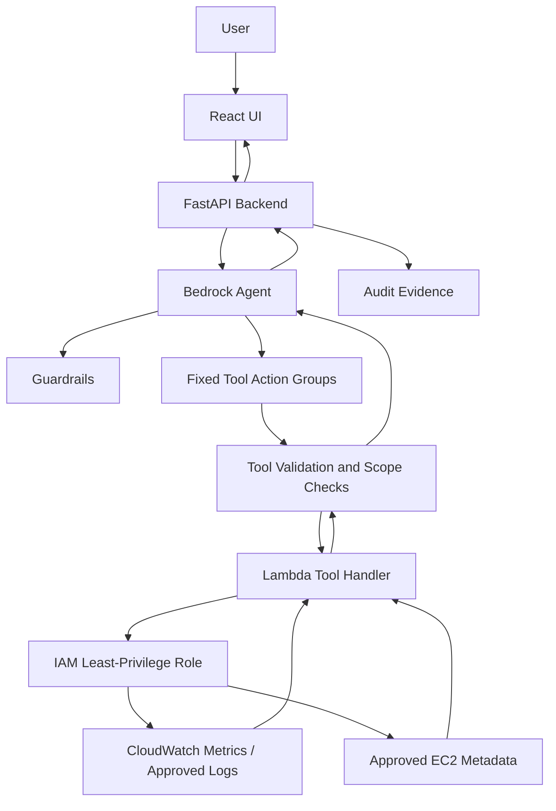

# CloudFence Architecture

## Architectural objective
Separate agent reasoning from authorization and execution. The agent may request a tool; trusted code validates the request and AWS IAM remains the independent permission boundary.

## Components
- **Frontend:** React + TypeScript chat and investigation UI.
- **Application backend:** FastAPI; authentication/session handling, scope configuration, request coordination and audit records.
- **Agent:** Amazon Bedrock Agent (or the eligible Bedrock managed harness selected for the implementation).
- **Action groups / tool adapters:** fixed operations with strict parameter validation.
- **AWS Lambda tool handlers:** execute narrowly defined read-only operations.
- **IAM:** least-privilege role attached to tool execution; no write/delete privileges.
- **CloudWatch:** permitted metrics and selected logs.
- **Bedrock Guardrails:** relevant content safety controls, not a substitute for authorization.
- **Audit/evidence:** application logs and AWS logging services; avoid logging secrets or unnecessary raw user data.

## Data flow
1. User asks an operational question.
2. Backend applies session and resource scope.
3. Agent interprets the request and proposes a supported tool call.
4. Tool handler validates tool name, parameters, resource scope, limits and time range.
5. IAM determines whether the underlying AWS API call is permitted.
6. Tool returns minimized, sanitized data.
7. Agent explains findings and uncertainty.
8. Backend records the request, tool, policy decision and outcome.

## Trust boundaries
- User ↔ application
- Application ↔ agent
- Agent ↔ action group
- Lambda ↔ AWS APIs
- AWS retrieved content ↔ agent context
- Logs/evidence ↔ privileged readers

## Mermaid

## Key security principle
Guardrails, prompt instructions and validation complement each other. IAM and trusted execution code—not the LLM—must enforce authorization.
